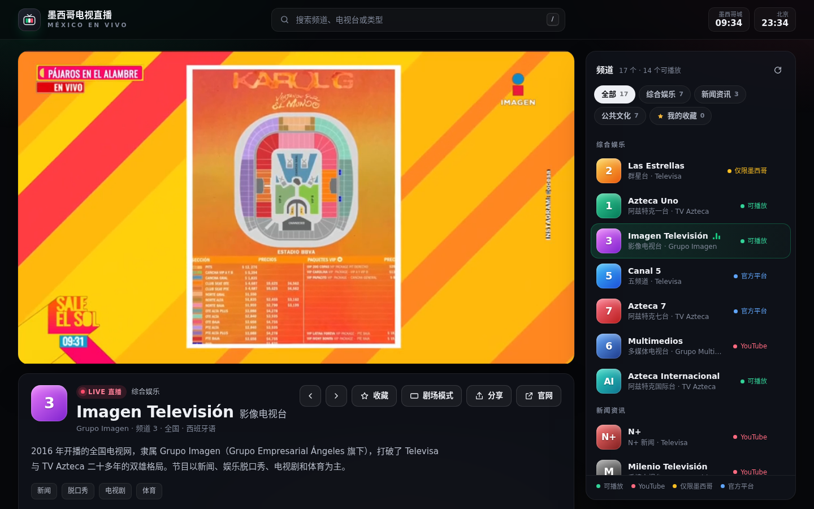

# 墨西哥电视直播 · México en Vivo

在网页上观看墨西哥主流电视频道的直播。深色现代界面，使用 Video.js 10 播放器（画质切换、画中画、全屏、快捷键），每个频道都配有中文简介。



## 运行

需要 Python 3.7 或更高版本（macOS、Linux 一般自带；Windows 可从 python.org 安装）。

```bash
cd mexico-tv-live
python3 serve.py          # Windows 用：python serve.py
```

然后用浏览器打开 <http://127.0.0.1:8000/>。

- 换端口：`python3 serve.py --port 9000`
- 让同一局域网里的手机访问：`python3 serve.py --host 0.0.0.0`，手机打开 `http://电脑的局域网IP:8000/`
- 也可以用任何静态服务器托管（例如 `npx serve .`、Nginx、GitHub Pages）。区别只在 YouTube 频道：没有 `serve.py` 的 `/api/youtube-live` 接口时，页面改为按频道 ID 嵌入直播，也能看，但不会提前判断频道此刻有没有在直播。
- 不能直接双击 `index.html`（`file://` 打开）：浏览器会拦截 ES 模块，YouTube 嵌入也需要页面有来源地址。

## 频道

| 频道 | 类型 | 信号 | 备注 |
| --- | --- | --- | --- |
| Las Estrellas（群星台） | 综合娱乐 | 官方 HLS 1080p | 仅限墨西哥境内 |
| Azteca Uno（阿兹特克一台） | 综合娱乐 | 官方 HLS 720p | 时移信号，约晚 1 小时 |
| Imagen Televisión（影像电视台） | 综合娱乐 | 官方 HLS 720p，备用 YouTube | 默认频道 |
| Canal 5（五频道） | 综合娱乐 | 无公开信号 | 提供 ViX 官方平台入口 |
| Azteca 7（阿兹特克七台） | 综合娱乐 | 无公开信号 | 提供 TV Azteca 官方直播页入口 |
| Multimedios（多媒体电视台） | 综合娱乐 | YouTube，备用官方 HLS | HLS 仅限墨西哥境内 |
| Azteca Internacional（阿兹特克国际台） | 综合娱乐 | 官方 HLS 1080p | |
| N+（N+ 新闻） | 新闻资讯 | YouTube | |
| Milenio Televisión（千禧电视台） | 新闻资讯 | YouTube | |
| adn Noticias（adn 新闻台） | 新闻资讯 | 官方 HLS 720p，备用 YouTube | |
| Canal Once（十一频道） | 公共文化 | 官方 HLS 1080p | |
| Canal 22（22 频道） | 公共文化 | 官方 HLS 1080p / 多码率，备用 YouTube | |
| TV UNAM（UNAM 大学电视台） | 公共文化 | 官方 HLS 720p | |
| Canal del Congreso（国会频道） | 公共文化 | 官方 HLS，备用 YouTube | 休会期间可能没有直播 |
| Capital 21（首都 21 台） | 公共文化 | 官方 HLS 1080p | 码率约 6 Mbps，需要较好的网速 |
| Mexiquense TV（墨西哥州电视台） | 公共文化 | 官方 HLS 1080p | |
| Justicia TV（司法电视台） | 公共文化 | 官方 HLS 720p | |

所有信号都来自电视台公开提供的官方地址或其官方 YouTube 频道。

## 功能

- 频道分类、搜索（中文、西班牙语都可以搜）、收藏（保存在浏览器本地）
- 打开页面时自动检测每路信号，列表中用颜色标出：可播放 / YouTube / 仅限墨西哥 / 官方平台
- 主信号失败时自动切换到备用信号；也可以在频道介绍下方手动选择信号源
- 播放器：直播标识、回到直播、画质切换、画中画、全屏、投屏（Chrome）、记住音量
- 浏览器禁止有声自动播放时，先静音播放，并显示“点击开启声音”
- 剧场模式；分享链接会直接打开当前频道（例如 `#/canal-22`）；顶部显示墨西哥城和北京时间
- 手机上播放器固定在顶部，下滑浏览频道列表时也能继续观看
- 快捷键：`空格` 播放/暂停，`M` 静音，`F` 全屏，`I` 画中画，`[` `]` 换台，`T` 剧场模式，`/` 搜索

## 观看限制

- **地区限制**：Las Estrellas，以及 Multimedios 的 HLS 备用信号，只允许墨西哥境内的网络播放，其他地区会显示“仅限墨西哥境内播放”。Canal 5 和 Azteca 7 没有可以公开嵌入的信号，页面只提供官方平台入口。
- **YouTube**：N+、Milenio、Multimedios 通过官方 YouTube 频道播放，需要当前网络能访问 YouTube。访问不了时页面会提示，并优先使用可以直连的 HLS 信号。
- **地址变化**：直播地址由各电视台自己维护，随时可能更换。某个频道失效时，在 `assets/js/channels.js` 里更新对应的 `url` 即可。

## 目录结构

```
index.html             页面结构
assets/css/app.css     样式（含手机端适配）
assets/js/channels.js  频道数据：名称、中文简介、信号源
assets/js/app.js       频道列表、信号检测与自动切换、播放器逻辑
serve.py               本地服务器 + YouTube 直播视频解析接口
vendor/videojs/        Video.js 10.2.0 播放器与 hls.js（已放在本地，不依赖 CDN）
docs/                  截图
```

## 添加频道

在 `assets/js/channels.js` 的 `CHANNELS` 数组里加一项，`sources` 按优先级排列：

```js
{
  id: 'mi-canal',
  name: 'Mi Canal',
  zh: '中文名',
  network: '所属电视台',
  category: 'news', // general | news | public
  reach: '全国',
  tags: ['新闻'],
  logo: { text: 'MC', from: '#60a5fa', to: '#1e3a8a' },
  website: 'https://example.mx/',
  intro: '一两句中文介绍。',
  sources: [
    { type: 'hls', url: 'https://.../playlist.m3u8', label: '官方信号', quality: '720p' },
    { type: 'youtube', channelId: 'UC...', label: 'YouTube 官方直播' },
  ],
},
```

## 版权与许可

本项目不存储、不转码、不转发任何音视频内容，节目版权归各电视台所有。播放器使用 [Video.js](https://videojs.org/)（Apache-2.0，内含 [hls.js](https://github.com/video-dev/hls.js)，同为 Apache-2.0），许可证见 `vendor/videojs/LICENSE`。
